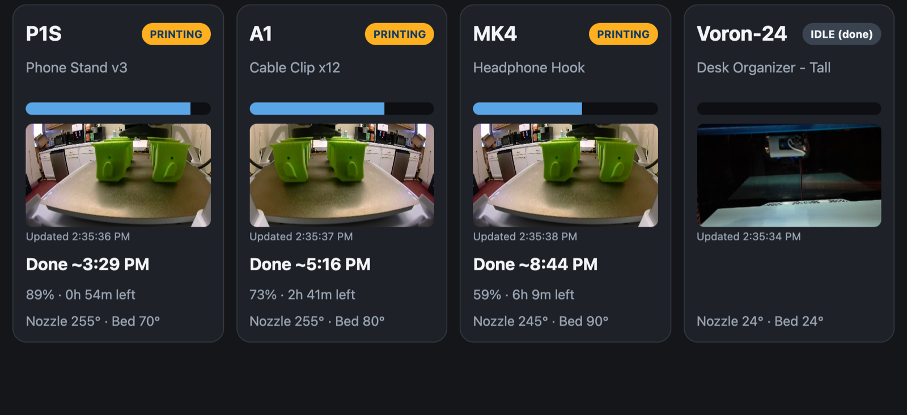
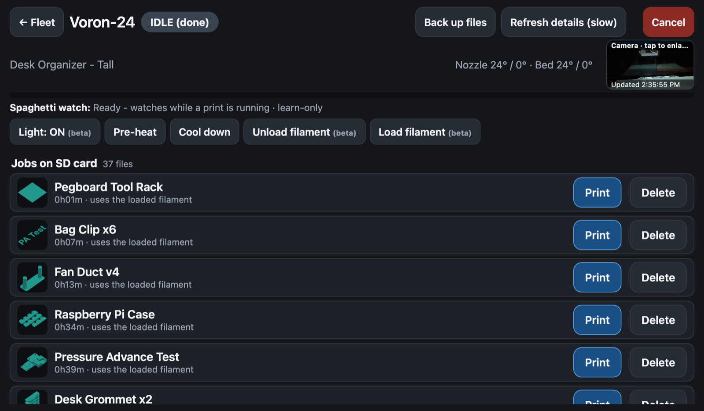
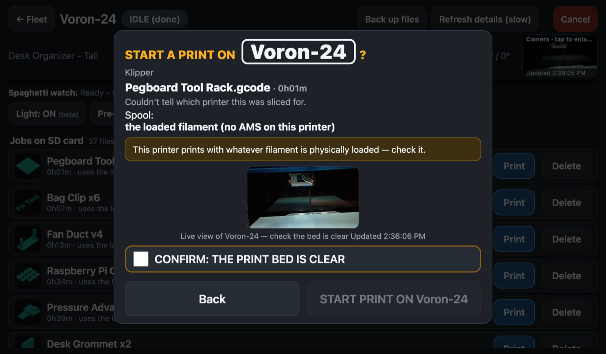
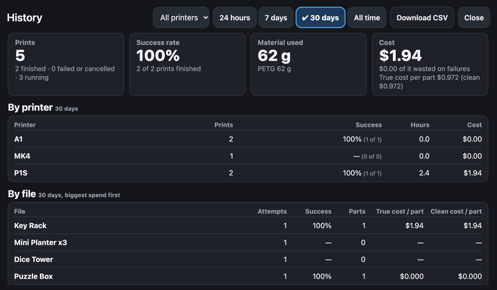

<p align="center">
  <picture>
    <source media="(prefers-color-scheme: dark)" srcset="app/static/brand/logo-lockup.svg">
    
  </picture>
</p>

<h1 align="center">Fabrica — Print Farm</h1>

<h3 align="center">Your whole print farm on one screen — and in your AI agent's hands.</h3>

<p align="center">
  Bambu Lab · Prusa · OctoPrint · Klipper &nbsp;|&nbsp; 100 % local, no cloud &nbsp;|&nbsp; Free &amp; open source
</p>

<p align="center">
  
</p>

## ✨ What it does

- 🖨️ **Every printer, one dashboard** — Bambu, Prusa, OctoPrint and Klipper side by side
- 📷 **Live cameras** — see every bed at a glance; tap for full screen
- ⏱️ **Real finish times** — "Done ~5:16 PM", not "2h 41m left"
- ▶️ **Start prints from the SD card** — pick the spool, see the bed, confirm, go
- 🧵 **AMS spool control** — colors shown as words, the right spool suggested for every job
- 🛡️ **Wrong-printer protection** — a file sliced for another printer is blocked before it starts
- 🍝 **Spaghetti detection** — AI watches every print and warns you when it fails *(Full edition)*
- 🔔 **Alerts to your phone** — Telegram, Discord, ntfy, email or webhook, with a photo
- 💰 **True cost per part** — filament cost (power and machine wear optional), failed prints included
- 📊 **Print history** — success rate, material used and cost, by printer and by file
- 🏷️ **Printer groups** — tag printers (Production, Workshop…) and see history and costs per group
- 📚 **One file library** — every file on every printer in one place: search, folders, details, send to any idle printer
- ✏️ **Rename files safely** — preview, approve, and the old file is removed only after the new one is verified
- 💾 **One-tap backups** — every file on every printer, saved and downloadable
- 🔎 **Finds your printers** — scans your network and fills in the details for you
- 🎛️ **Printer controls** — light, pre-heat, cool down, load and unload filament
- 🤖 **Agent-first** — 47 MCP tools: let Claude or any AI agent run your farm
- 🧭 **Agents teach themselves** — connect an agent and Fabrica hands it the rules and guides, and tells it when anything changes
- 🔐 **Safe by design** — API keys, optional sign-in, and a human confirms every print start
- 📱 **iPhone and Android ready** — add it to your Home Screen and it works like an app
- 📺 **Wall-screen ready** — built for a 10″ touchscreen next to your printers

## 📸 See it

| Pick a job | Start it safely |
|---|---|
|  |  |

| Know what every print costs |
|---|
|  |

## 🤖 Talk to your print farm

```
You:    What's printing, and when is it done?
Agent:  3 of 4 printers busy. P1S finishes ~3:29 PM, A1 ~5:16 PM, MK4 ~8:44 PM. The Voron is free.
You:    Put the Phone Stand on the Voron.
Agent:  Phone Stand v3, 1h 12m. I can see the bed on the camera — is it clear?
You:    Yes.
Agent:  ✅ Printing on the Voron.
```

## 🪶 Two editions

| | 🪶 **Lite** | 💪 **Full** |
|---|---|---|
| Runs on | **Raspberry Pi 4** — or anything with Docker | Mac, PC or NAS |
| Every feature above | ✅ | ✅ |
| 🍝 Spaghetti detection | — | ✅ |

Both are the same app. Full adds the detector next to it with one extra command.

## 🚀 Get started

```bash
git clone https://github.com/wsturner88/fabrica.git && cd fabrica
docker compose -f docker-compose.ghcr.yml up -d
```
Open `http://<your-machine>:8271/dashboard` and add your first printer.

👉 **[Step-by-step install](docs/INSTALL.md)** (Lite and Full, about 10 minutes)

## 📚 Learn more
[Full guide](docs/GUIDE.md) · [Spaghetti detection](docs/detection.md) · [Settings](docs/settings.md) ·
[Printer types](docs/drivers.md) · [History & costs](docs/joblog.md) · [Network discovery](docs/discovery.md)

---
<sub>MIT licensed. Not affiliated with Bambu Lab, Prusa Research, OctoPrint or Klipper. Spaghetti detection uses
the open-source Obico model (AGPL-3.0), downloaded unmodified from its own registry.</sub>
